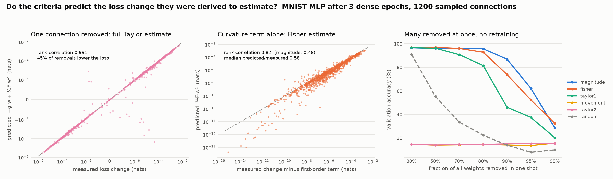

# DESIGN

The four questions from the brief, in order:

1. [Derive the importance criterion; why it approximates the loss change from removing a connection](#1-the-importance-criterion)
2. [What the engine computes as "the gradient of a masked weight", and why](#2-the-gradient-of-a-masked-weight)
3. [Where the engine bottlenecks, and how to optimise it](#3-where-the-engine-bottlenecks)
4. [How to serve a self-pruned model in a multi-tenant inference service](#4-serving-at-scale)

---

## 1. The importance criterion

The criterion is `s_i = ½ · F_ii · w_i²`: the curvature term of the loss
change from removing connection `i`, with the curvature estimated by the
diagonal Fisher information.

### 1.1 Derivation

Removing connection `i` sets `w_i → 0`, a perturbation `δ = −w_i e_i`. A
second-order Taylor expansion of the loss gives

```
ΔL_i = L(w − w_i e_i) − L(w) = −g_i w_i + ½ H_ii w_i² + O(w_i³)
       g = ∂L/∂w,  H = ∂²L/∂w²
```

**Curvature without second derivatives.** For cross-entropy,
`ℓ = −log p(y|x; w)`:

```
∇² log p = ∇²p / p − (∇ log p)(∇ log p)ᵀ
⇒  H = E[(∇ℓ)(∇ℓ)ᵀ] − E[∇²p / p]
```

If labels follow the model's own predictions, the last term vanishes:
`Σ_y ∇²p(y|x) = ∇² Σ_y p(y|x) = ∇²1 = 0`. That leaves `H ≈ F`, where
`F_ii = E_sample[(∂ℓ/∂w_i)²]` needs only first derivatives. The approximation
is only as good as the model's calibration, which is why §1.3 measures it.

**From batch gradients to per-sample moments.** Training only sees the batch
mean gradient `g_B`, and `E[g_B²] = ḡ² + Var(g_sample)/B`. So the per-sample
Fisher is

```
F = ḡ² + B · (E[g_B²] − ḡ²)
```

with `ḡ` and `E[g_B²]` tracked as bias-corrected moving averages
(`prune/criteria.py`, `GradStats`). Using `E[g_B²]` directly would be wrong by
about a factor of `B`, and by a different amount for each weight.

**What the score means for a linear layer.** The per-sample gradient there is
`x_i δ_j` (input times backpropagated error), so `s_ij = ½ w_ij² E[x_i² δ_j²]`.
A connection matters only if its weight is large, **and** its input is active,
**and** its output unit affects the loss.

### 1.2 Why the first-order term is dropped

The loss expansion for a whole set `S` of removals is

```
ΔL(S) = −Σ_{i∈S} g_i w_i  +  ½ Σ_{i,j∈S} H_ij w_i w_j
```

The first-order sum treats loss *reductions* as additive, and they are not.

- Ranking by `−g_i w_i` picks the connections the loss is most sensitive to.
  It then moves each one all the way to zero, far outside the region where the
  linearisation holds.
- The first-order gain is the descent the optimizer is about to collect
  anyway, so it is not a benefit of pruning.

Measured: removing the lowest-scoring 30% of weights at once leaves
96.7–97.0% accuracy under the curvature-only criteria. Under the signed
criteria it leaves **14.7%**, while random pruning keeps 91.1%. So the score
keeps only the curvature term. This is Optimal Brain Damage's form, but
justified differently: `g` is not zero mid-training; it is dropped because it
does not add up across removals.

### 1.3 Does it estimate the loss change? (measured)

`uv run python -m train.criterion_check` freezes a network after 3 epochs
(97.0% validation accuracy). For 1,200 random connections it removes each one,
re-measures the loss on a fixed set of 10,000 examples, and restores it.



- The full expansion (`−g w + ½ F w²`) predicts the measured loss change with
  rank correlation **0.991**.
- Against the measured curvature term (measured change minus the exact
  first-order term), `½ F w²` has rank correlation **0.82**. Magnitude has
  0.48.

**Magnitude, in the same terms, is `½ w²`.** It is this criterion with `F_ii`
assumed equal for every connection. That holds only when curvature is uniform.
`tests/test_prune.py` builds a case where curvature varies by 10⁴: there
Fisher ranks removals with correlation above 0.9, and magnitude below 0.3.

### 1.4 Does it prune better than magnitude? (measured: no)

On the test split with ten seeds (README, Part 4), magnitude is better at
90–95% sparsity (+0.245 points at 95%, magnitude better in 10 of 10 seeds).
There is no difference at 98–99%.

The validation ablations (3 seeds) show where the gap comes from:

- **Fisher does what it was derived to do.** Over the schedule to 95%, its
  mask updates raise the loss by 0.22–0.23 nats in total, against 0.88–1.06 for
  magnitude. It removes connections with 4–5× less immediate damage, and still
  finishes lower.
- **The gap comes from how the budget is split between layers.** Forced to
  the same 95% sparsity in every layer, the two are indistinguishable (97.41
  vs 97.38). Ranked globally, Fisher keeps the 10-unit output layer much
  denser (31.6% sparse, against 67.4% for magnitude) and pays for it in the
  middle layer.

My reading, offered as a hypothesis: a diagonal, local score predicts the
loss jump at the instant of removal. The network then trains for thousands
more steps, and the remaining weights compensate. The relevant quantity is the
loss *after* that compensation (Optimal Brain Surgeon's `w_i² / (2 [H⁻¹]_ii)`).
Output-layer connections are sensitive at the moment of removal but easy to
compensate for, so a diagonal score over-protects them.

**Where Fisher still wins.**

- **Speed:** it removes whole units, which is what makes a pruned network
  actually run faster (§4.1).
- **Regrowth:** its gradient statistics are the signal regrowth uses.
  Magnitude cannot supply one, because a masked weight has no magnitude.

### 1.5 Schedule

The sparsity target follows `s(t) = s_f · (1 − (1 − (t − t₀)/(t₁ − t₀))³)`:

- `t₀` is 10% and `t₁` 70% of training, with a mask update every 100 steps.
- After `t₁`, the network fine-tunes with the mask frozen.
- The budget at the end is exact: `floor((1 − s_f) · N)` weights.

**Why gradual:** every score is local. The cross terms in §1.2 grow with the
square of the number of connections removed together. Small steps, each
followed by retraining and rescoring, keep the score valid.

**Why cubic:** most of the redundancy is removed early, when the most
training remains to recover from it. The ramp then slows as each remaining
connection carries more of the function.

**Measured at 95%:** pruning once at `t₁` instead costs 1.5 points
(magnitude) and 3.3 points (Fisher).

### 1.6 Regrowth and stability

With `--regrow f`, each mask update swaps connections and keeps the budget
unchanged:

- The `k` weakest active connections are dropped.
- The `k` masked connections with the largest `|E[∂L/∂w]|` are revived.
  `|E[g]|` is used because Adam moves a new weight by about `lr` per step, so
  the loss it can recover early is ≈ `lr · T · |E[g]|`.
- `f` decays to 0 over the pruning phase, so the mask is fixed during
  fine-tuning.

Stability comes from four properties:

- A revived weight starts at exactly 0, so reviving it does not change the
  network function.
- Its optimizer state and bias-correction age are reset (§2.4).
- A connection pruned in an update cannot be revived in that same update.
- The budget is checked on the effective weights.

Measured result: training is stable, but almost every revived connection is
pruned again. A newborn weight is 0, every score is proportional to `w²`, so
it ranks last at the next update. A one-update grace period (`--regrow-grace`)
helps survival, but accuracy changes by at most about 0.1 point at 95%.
Regrowth is therefore off by default. It would need a score for new
connections that does not depend on `w²`.

---

## 2. The gradient of a masked weight

### 2.1 Two derivatives, two jobs

The engine keeps the stored value `θ` separate from the effective value
`w = m ⊙ θ` (`Parameter.effective()`). The mask product is a node in the
graph, not a clean-up step between iterations. Two different quantities could
be called "the gradient of a masked weight":

| | definition | at a masked coordinate | used by |
|---|---|---|---|
| `param.grad` | ∂L/∂θ = m ⊙ ∂L/∂w | **exactly 0** | the optimizer |
| `param.dense_grad` | ∂L/∂w | generally non-zero | pruning / regrowth scores only |

**`grad = m ⊙ ∂L/∂w` is the right thing to optimise with.** It is the chain
rule through `w = m ⊙ θ`.

- A masked `θ_i` does not affect the loss, so its derivative is 0; the
  finite-difference check confirms it
  (`test_both_gradients_agree_with_finite_differences`).
- Equivalently, pruning imposes the constraint `θ_i = 0`, and `m ⊙ g` is the
  gradient projected onto that constraint. Training with it is projected
  gradient descent on the sparse network.

**`dense_grad` is the right thing to score regrowth with.** At `w_i = 0`,
`L(w + ε e_i) − L(w) ≈ ε ∂L/∂w_i`: it is the rate at which the loss would
change if the connection were switched back on. It describes a connection that
does not currently exist, so it must never drive an update. The mask node's
backward pass stores it on the side, at the cost of one array copy.

The mask is captured when the forward pass runs. If it changes before
`backward()`, the gradient still matches the forward pass that produced the
loss (`test_backward_uses_the_mask_from_the_forward_pass_that_built_the_graph`).

### 2.2 What the quick implementation gets wrong

The common shortcut writes zeros into the weight array and runs a normal dense
backward pass. Masked weights then get `∂L/∂w` and move off zero on the next
step. Re-zeroing them after every step hides that, but the optimizer keeps
building state for connections that do not exist.

### 2.3 A zero gradient is not enough

Both hazards below are reproduced in `tests/test_optimizer_masking.py`, with
a textbook Adam running on this same engine.

**Hazard 1: ghost updates.** With `g = 0`, Adam's step `lr · m̂/(√v̂ + ε)` stays
non-zero for as long as `m` remembers gradients from before pruning. Summing
the geometric series, a pruned weight drifts by

```
lr · (m/√v) · r/(1−r),   r = β₁/√β₂ ≈ 0.9005   →   ≈ 9 · lr · m/√v
```

Heavy-ball momentum behaves the same way, and weight decay is a third way a
"frozen" weight can move.

**Hazard 2: stale state on revival.**

- *Stale first moment.* `m` points where the loss sloped before pruning, but
  the weight is now at 0, so the first steps can go *against* the current
  gradient (`test_stale_first_moment_moves_a_revived_weight_against_its_gradient`).
- *Wrong bias correction.* After a long time masked, `m` and `v` have decayed
  to ≈ 0, so the coordinate is effectively at Adam step 0. But the global step
  counter `t` is large, so bias correction does nothing. With a constant
  gradient, the step `k` updates after revival is

  ```
  step_k = lr · (1 − β₁ᵏ) / √(1 − β₂ᵏ)      (correct Adam: lr)
  k = 1: 3.16·lr    k ≈ 12: 6.6·lr (peak)    k = 1000: 1.26·lr
  ```

  So a revived weight trains at 3–6× the intended rate for hundreds of steps.

### 2.4 What this implementation does (`nn/optim.py`)

Optimizer state is per connection, and exists only while the connection does:

1. **A masked weight never moves.** The final update is multiplied by the
   mask, after momentum, normalisation and weight decay.
2. **Any flip resets that coordinate** to a newly created parameter's state:
   `m = v = 0` and age 0. A newly pruned weight's stored value is set to
   exactly 0, so a revived weight restarts from 0. That keeps the loss
   continuous; restoring the old value would reintroduce a weight tuned for a
   network that has since changed.
3. **Bias correction is per coordinate.** The optimizer keeps `β₁^age` and
   `β₂^age` for each coordinate instead of using one global `t`.

`Parameter.set_mask` is the only way to change a mask (the mask array is
read-only). It OR-accumulates the coordinates that flipped, so a connection
pruned and revived between two optimizer steps is still reset.

### 2.5 The guarantees, as tests

The tests state two exact equivalences, which hold for Adam and SGD-momentum,
with and without weight decay:

- **A static mask equals a smaller dense model.** The active coordinates
  follow the same trajectory, to 1e-14, as an unmasked parameter holding only
  those coordinates. The masked coordinates and their state stay exactly 0.
- **Revival equals a new parameter.** After pruning for 0, 1 or 25 steps and
  then reviving, the connection follows the same trajectory, to 1e-14, as a
  fresh parameter initialised at 0 under a fresh optimizer
  (`test_revived_connection_trains_exactly_like_a_new_parameter`).

---

## 3. Where the engine bottlenecks

`uv run python -m train.profile_step` times one training step of the MNIST
model (235k parameters, batch 128) on an Apple M2 with NumPy 2.5.5
(Accelerate):

| configuration | ms / step | forward | backward | optimizer (Adam) |
|---|---|---|---|---|
| float32, dense | 0.91 | 18% | 29% | **53%** |
| float32, 90% of weights masked | 1.37 | 23% | 34% | 43% |
| float32, dense, batch 1 | 0.82 | 6% | 35% | 59% |

1. **The optimizer is the largest cost, not the matmuls.** On the 784×256
   layer, the forward matmul takes 0.05 ms and the Adam update 0.36 ms. Adam
   makes about ten elementwise passes over the weights, and almost every pass
   allocates a new temporary array.
2. **Step cost barely depends on batch size**, because everything that scales
   with the number of parameters is paid once per step.
3. **Masking makes training slower** (+50% at 90% sparsity). The matmul still
   multiplies the zeros, and the mask adds work on top. Masked training here
   is *honest* (true zeros) but not *cheap*.

Python overhead (graph construction, topological sort, closures) is about 5%
at this size.

**Already done:**

- The topological sort is iterative.
- Gradients are not computed for inputs that don't require them, which skips
  the largest matmul.
- A node's first incoming gradient is stored by reference, not copied.
- Intermediate gradients are freed as soon as they are used.
- Softmax and cross-entropy are fused into one node with the closed-form
  gradient `(softmax − onehot)/N`.
- Everything runs in float32 end to end.

**Next, in order of payoff:**

1. **An allocation-free Adam.** Using `out=` buffers measured 0.36 → 0.24 ms
   on the large layer. Better still is one fused compiled loop over
   `(g, m, v, w)`.
2. **Sparse storage during training.** Store the active weights in CSR form.
   The optimizer then touches only the non-zero weights, and the weight
   gradient is computed only for active pairs. The dense gradient needed for
   regrowth is computed only on rescoring steps.
3. **A fused `Linear` node and a replayed graph.** An MLP builds the same
   graph every step, so recording it once and replaying it with preallocated
   buffers removes Python overhead and allocation.
4. **Beyond one core:** the elementwise work is memory-bound, so it needs
   fewer passes over memory (item 1) or a GPU array library behind the same
   `Tensor` API, not more threads.

---

## 4. Serving at scale

### 4.1 What the measurements say

From `uv run python -m infer.benchmark`, on one core (numbers in the README):

- **Multiplying by zeros saves nothing.** The dense-times-zero shortcut costs
  the same as the unpruned network.
- **A sparse kernel reduces work but not time.** CSR does 20× fewer
  multiply-accumulates, yet it was slower than dense BLAS in all 24
  comparisons, because it loses on constant factors.
- **Structure is what turns sparsity into speed.** When whole units die, the
  matrices get smaller. Padded to BLAS-friendly widths, the 95% Fisher network
  runs 1.30× faster at batch 256. The magnitude network keeps every unit and
  runs no faster.
- **Memory falls regardless of kernel:** 96 KB in CSR form against 919 KB
  dense.

### 4.2 Export: ship structure, verified

1. **Compact exactly.** Remove inputs and units that cannot affect the output,
   and fold constant units into the next layer's bias (`infer.sparse.compact`).
   This changes no prediction.
2. **Pick the kernel per layer by measurement**, on the target hardware at the
   target batch size. The sparsity level alone does not predict the winner.
3. **Prune to a shape the hardware accelerates.** For example, 2:4 structured
   sparsity on NVIDIA sparse tensor cores, or whole units, blocks or channels
   on CPU BLAS. A group criterion (the Fisher score summed over a unit or a
   block) is a small change to `prune/criteria.py`. Then quantise to int8;
   the savings multiply.
4. **Gate every release on an equivalence check.** The exported model must
   reproduce the reference predictions, and logits within a tolerance, on a
   fixed golden set. The benchmark does exactly this for every path on all
   10,000 test images.
5. **Version every artifact.** Each one records its config, seed, mask hash
   and measured accuracy, and is addressed by content hash, so a rollback is
   just a pointer change.

### 4.3 The multi-tenant serving path

```
client ─► gateway ─► router ─► per-model queue ─► dynamic batcher ─► worker (1 process per core)
          auth,       model id     bounded,           max batch B,        BLAS pinned to 1 thread,
          tenant      + version    per-tenant         max wait τ          compacted model
          quotas      → pool       fair share         (from the SLO)      resident in memory
```

- **Batching is where the throughput is.** One core spends 9.8 µs on a single
  request, but 0.74 µs per example at batch 256. A dynamic batcher that waits
  at most τ (1–2 ms, set from the latency SLO) captures most of that.
  Different models or tenant variants cannot share a batch, so batching is per
  model version.
- **For a model this small, compute is not the bottleneck.** Parsing a
  request, the Python call path and the network stack cost more than a
  9.8 µs forward pass. I have not measured those overheads; this is an
  estimate. At thousands of requests per second the work is request handling,
  and pruning saves little per request.
- **Where pruning pays in a multi-tenant service is memory.** Hosts are
  limited by how many tenant variants fit in memory, and loading a cold
  variant is the worst tail-latency event.
  - At 96 KB instead of 919 KB, about 10× more variants fit in memory.
  - Keep variants in CSR form at rest and in the cache; expand a variant to
    the padded dense form once it gets frequent traffic.
- **Isolation.**
  - Per-tenant token-bucket quotas at the gateway.
  - Weighted fair queueing per tenant, so one tenant's burst cannot starve
    the others.
  - Bounded queues that reject early (HTTP 429) instead of letting latency
    grow without limit.
- **Workers.** One process per core with one BLAS thread, which is the
  configuration that was benchmarked, so capacity planning uses measured
  numbers. Production would run the compacted model in a compiled runtime and
  keep NumPy as the reference for the equivalence check.
- **Rollout and monitoring.**
  - Shadow traffic first, then a canary with automatic rollback on latency,
    error-rate or disagreement alarms.
  - Autoscale on queue delay and p99 latency, not CPU.
  - Watch agreement with the dense reference on live traffic: a pruned model
    has less spare capacity, so it may degrade sooner under drift.
