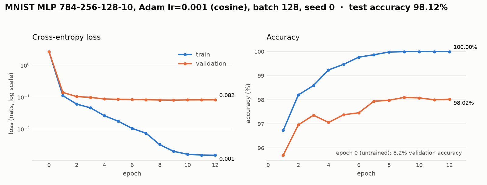
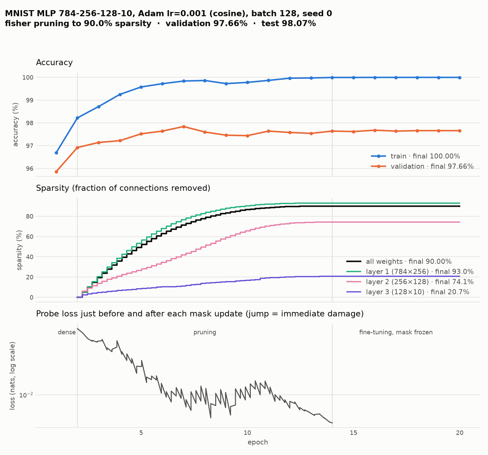
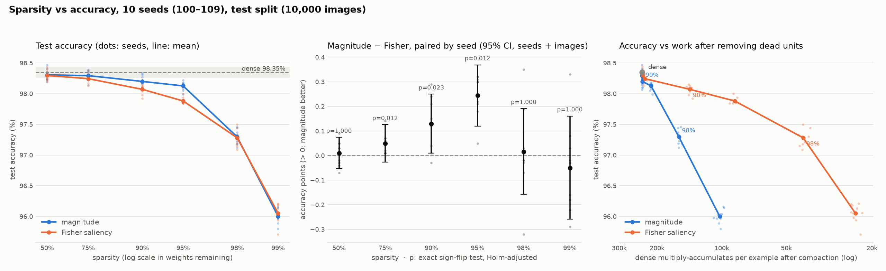
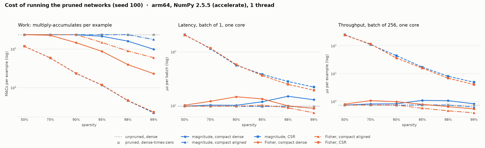

# The Self-Pruning Network

A reverse-mode autodiff engine, Adam, an MLP and a self-pruning training loop,
written from scratch in Python and NumPy.

No autodiff, neural-network or pruning library is used. **scikit-learn is not
used at all, not even to load data**: MNIST is downloaded and parsed with the
standard library and checked against SHA-256 hashes (`train/data.py`).
Matplotlib is used only for plots.

## Setup

Python ≥ 3.10 and [uv](https://docs.astral.sh/uv/):

```bash
uv sync
```

Without uv: `pip install numpy matplotlib pytest`, then drop `uv run` below.

## Commands

```bash
uv run pytest                                   # all tests (≈7 s, no network)
uv run pytest tests/test_gradcheck.py           # Part 1: gradient checks for every op
uv run pytest tests/test_masked_weights.py tests/test_optimizer_masking.py   # Part 1: masked-weight correctness

uv run python -m train.train_mlp                # Part 2: train the MLP on MNIST (≈10 s; downloads MNIST once, 11 MB)
uv run python -m train.prune_mlp                # Part 3: self-pruning run to 90% sparsity (≈30 s)
uv run python -m train.pareto                   # Part 4: Pareto sweep, 130 runs (≈35 min on 4 cores, resumable)
uv run python -m infer.benchmark                # Part 4: inference cost of the pruned networks (≈2 min)
```

Seeds are fixed everywhere. `results/part4/runs.json` doubles as the sweep's
cache, so rerunning `train.pareto` in place only redoes the analysis; to
retrain all 130 runs use `--out <empty dir>`.

## Layout

```
engine/   Tensor, graph and backward(); ops; Parameter with a pruning mask; gradient checker
nn/       layers, MLP, initialisers, SGD-momentum and Adam with mask-aware state
prune/    importance criteria, sparsity schedules, the pruner (exact budget, regrowth)
train/    data, training loop, entry points, Pareto sweep and its statistics, plots
infer/    exact compaction of a pruned network; dense, compact and CSR forward paths; benchmark
tests/    gradient checks, masked-weight and optimizer-state tests, pruning, inference, statistics
results/  committed plots and raw numbers for Parts 2–4
```

## Part 1: autodiff engine

- **Ops:** add, sub, mul, div, matmul, sum, mean, ReLU, tanh, sigmoid, GELU,
  and a fused, numerically stable softmax cross-entropy (plus neg, pow, exp,
  log, reshape, transpose). Broadcasting is undone in backward, so
  `(N, D) + (D,)` sums the gradient over `N`.
- **Gradient checks:** every op is checked against central differences. A
  test scans the engine source and fails if an op has no check.
- **Masked weights:** the effective weight `w = m ⊙ θ` is a graph node.
  `param.grad` is exactly 0 at masked coordinates; `param.dense_grad = ∂L/∂w`
  is kept separately for pruning and regrowth scores.
- **Optimizer state:** a masked weight never moves. When a connection is
  pruned or revived, its Adam moments are reset and its bias-correction age
  restarts at 0. The tests reproduce both failure modes with a textbook Adam,
  then show that a revived connection trains exactly like a new parameter
  under a new optimizer.

Why this is the right gradient: [DESIGN.md §2](DESIGN.md#2-the-gradient-of-a-masked-weight).

## Part 2: training

A 784-256-128-10 ReLU MLP on MNIST: Adam, batch 128, lr 1e-3 with cosine
decay, 12 epochs, float32, seed 0. 5,000 training images are held out for
validation; the test set is evaluated once at the end.



| | loss | accuracy |
|---|---|---|
| untrained, validation | 2.680 | 8.2% |
| validation, epoch 12 | 0.0819 | 98.02% |
| **test** | 0.0641 | **98.12%** |

Raw per-epoch numbers: `results/part2/mnist_history.json`.
`--dataset spirals` trains on a synthetic dataset instead (99.3% test).

**Initialisation.** Hidden layers use He normal, `Var(w) = 2/fan_in`.
ReLU zeroes half of a symmetric pre-activation, so this variance keeps the
signal's second moment constant from layer to layer. In a 20-layer ReLU stack
the output/input ratio is 0.88 with He, against 8.4e-7 with `1/fan_in`. The
output layer uses LeCun normal, `1/fan_in`, because no ReLU follows it, so the
logits start at unit scale (initial loss 2.68 ≈ ln 10). Biases start at 0. The
derivation is in `nn/init.py`; `tests/test_nn.py` checks it.

**Stability.** Training runs under `np.errstate(over/invalid/divide="raise")`
and stops on a non-finite loss, so a NaN cannot pass silently; both guards are
tested. The gradient norm falls smoothly from 1.3 to 0.055.

## Part 3: the network prunes itself

`train.prune_mlp` trains for 20 epochs: dense warm-up for the first 10% of
steps, then a cubic sparsity ramp until 70% of steps, then fine-tuning with
the mask frozen. Every 100 steps it scores the active connections and removes
the lowest-scoring ones until that step's budget is met.

- **Criterion:** `½ · F_ii · w_i²`. This is the second-order Taylor term of the
  loss increase from removing connection `i`, with the curvature estimated by
  the diagonal Fisher information from gradients training already computes.
  Derivation and measurements: [DESIGN.md §1](DESIGN.md#1-the-importance-criterion).
- **Honest masking:** pruned weights are exact zeros, both in storage and in
  the forward pass.
- **Hard budget:** exactly `floor((1 − s) · N)` weights remain, checked at the
  end of every run. Biases are not pruned.
- **Regrowth (optional):** `--regrow 0.2` revives the masked connections with
  the largest mean dense gradient.



At 90% sparsity (seed 0), 23,475 of 234,752 weights remain, with 98.07% test
accuracy (dense: 98.12%).

**Design choices, measured on the validation split (3 seeds, 95% sparsity):**

- Gradual cubic pruning beats one-shot by 1.5 points (magnitude) and 3.3
  points (Fisher).
- Criteria that keep the signed first-order term collapse: movement ends at
  36.5% and first+second-order Taylor at 95.2%, against 92.2% for random
  pruning.
- Regrowth is stable but gains at most ≈ 0.1 point, so it is off by default.

Raw numbers: `results/part3/*.json`.

## Part 4: evidence

All design decisions above used the validation split and seeds 0–2. The sweep
uses ten new seeds (100–109) and the test split. Every sparsity level is run
for both criteria on all ten seeds, plus a dense run per seed: 130 runs.



### Sparsity vs accuracy (test split, mean ± std over 10 seeds)

The dense network scores 98.35 ± 0.09%. "Difference" is magnitude − Fisher,
paired by seed. Its 95% interval comes from a bootstrap that resamples both
seeds and test images, so it covers test-set noise as well as training noise.
p is an exact sign-flip test, Holm-adjusted over the six levels.

| sparsity | weights left | magnitude | Fisher | difference [95% CI] | p | magnitude better |
|---|---|---|---|---|---|---|
| 50% | 117,376 | 98.31 ± 0.09 | 98.30 ± 0.08 | +0.010 [−0.05, +0.07] | 1.000 | 6/10 |
| 75% | 58,688 | 98.29 ± 0.08 | 98.25 ± 0.07 | +0.049 [−0.03, +0.13] | 0.012 | 10/10 |
| 90% | 23,475 | 98.20 ± 0.09 | 98.07 ± 0.07 | +0.129 [+0.01, +0.25] | 0.023 | 9/10 |
| 95% | 11,737 | 98.13 ± 0.07 | 97.88 ± 0.05 | +0.245 [+0.12, +0.37] | 0.012 | 10/10 |
| 98% | 4,695 | 97.30 ± 0.11 | 97.28 ± 0.13 | +0.015 [−0.16, +0.19] | 1.000 | 5/10 |
| 99% | 2,347 | 96.00 ± 0.11 | 96.05 ± 0.15 | −0.051 [−0.26, +0.16] | 1.000 | 3/10 |

Raw numbers: `results/part4/runs.json` has one record per run, including which
test images each network got right. `results/part4/pareto.json` has the
analysis.

**Is my criterion better than magnitude? No.** At 90–95% sparsity magnitude
is better. The gap has the same sign in 9–10 of 10 seed pairs, the sign-flip
test rejects "no difference", and the interval stays above zero even with
test images resampled. At 75% the gap is within test-set noise, and at 98–99%
there is no detectable difference.

### The falsifiable claim

> **At 95% sparsity, magnitude pruning retains 98.13% test accuracy versus
> 97.88% for Fisher-saliency pruning, averaged over 10 seeds (dense 98.35%).**
> The paired difference is +0.245 points, 95% CI [+0.12, +0.37], exact
> sign-flip p = 0.002 for this single comparison, and magnitude is better in
> 10 of 10 seeds.

The claim is falsified if rerunning `uv run python -m train.pareto --out <new dir>`
gives a paired difference ≤ 0, or an interval that includes 0.

### Real cost

`infer.benchmark` runs the seed-100 network at each sparsity level through
four forward paths (`infer/sparse.py`), on one core with one BLAS thread:

- **dense:** the full matrices with zeros in them, i.e. the dense-times-zero
  shortcut.
- **compact dense:** dead inputs and units removed exactly, then dense
  products.
- **compact aligned:** the same compaction, with hidden widths padded to a
  multiple of 32.
- **CSR:** only the surviving weights are multiplied.

Every path predicts the same class as the dense pass on all 10,000 test
images.



| 95% network | path | MACs / example | KB | batch 1, µs | batch 256, µs / example |
|---|---|---|---|---|---|
| unpruned | dense | 234,752 | 919 | 9.8 | 0.74 |
| magnitude | dense-times-zero | 234,752 | 919 | 9.6 | 0.74 |
| magnitude | CSR | 11,596 | 96 | 38.2 | 17.09 |
| Fisher | compact aligned | 147,200 | 576 | 10.2 | 0.57 (1.30× faster) |
| Fisher | CSR | 11,737 | 96 | 36.3 | 15.79 |

What this shows:

- **The dense-times-zero shortcut is not a speed-up.** It costs the same as
  the unpruned network, because it does the same work.
- **Pruning really reduces work and memory.** At 95% sparsity, 20× fewer
  multiply-accumulates and 9.5× less parameter memory (in CSR form).
- **My NumPy CSR kernel is still slower than dense BLAS** at every sparsity
  up to 99%, in all 24 comparisons. It loses on constant factors, not on the
  amount of work.
- **Speed comes from structure.** Fisher pruning removes whole units (99 of
  256 in the first layer at 95%; magnitude removes none), giving smaller dense
  matrices: 0.41× the compact work of the magnitude network, in 10 of 10
  seeds.
  - Those smaller matrices only run faster once padded to BLAS-friendly
    widths: an odd-shaped 154×121 product took 29 µs, a padded 160×128 one
    12 µs.
  - Padded, the Fisher network is 1.30× faster than the unpruned one at
    batch 256 (1.90× at 99% sparsity). The magnitude network is not faster
    (0.98×).
- **So the two criteria trade accuracy against speed.** Magnitude is more
  accurate; Fisher runs faster.

Wall-clock times are from one machine (Apple M2, NumPy 2.5.5, Accelerate) and
are not a general claim. The MAC and byte counts are exact. Raw numbers:
`results/part4/cost.json`.

Answers to the DESIGN.md questions (criterion derivation, masked-weight
gradient, bottlenecks, serving at scale): [DESIGN.md](DESIGN.md).
